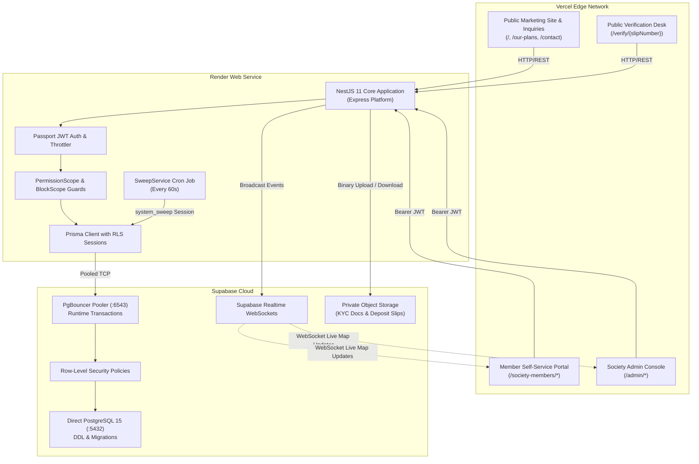
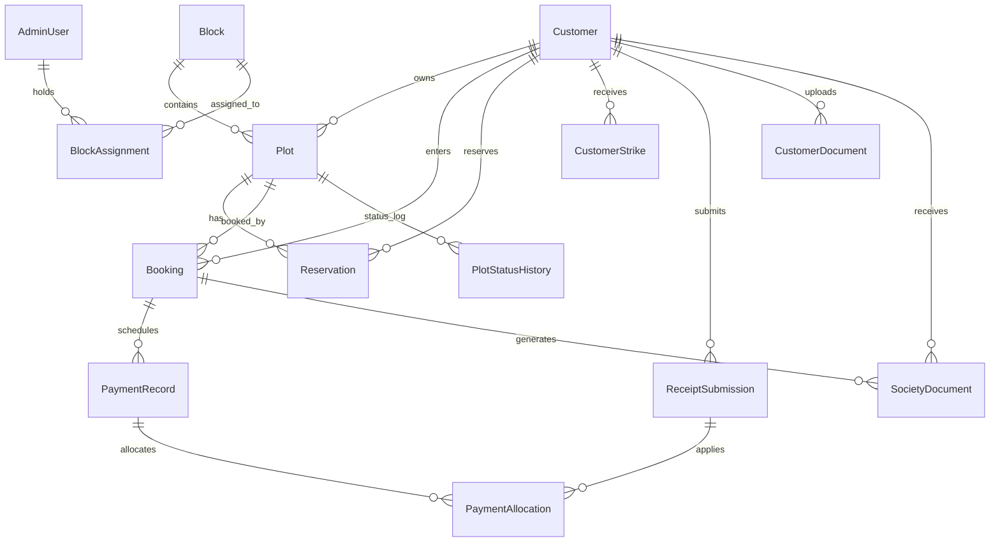
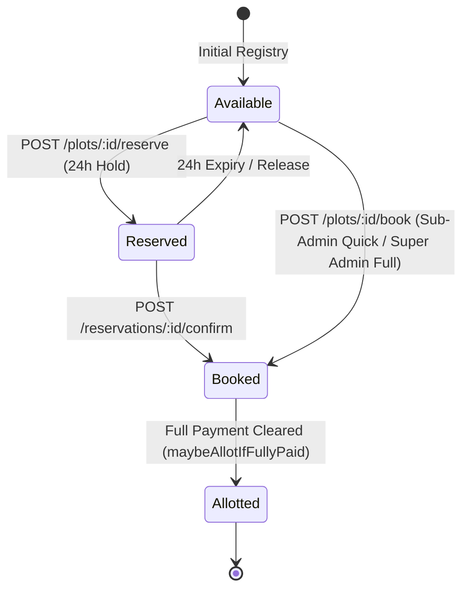
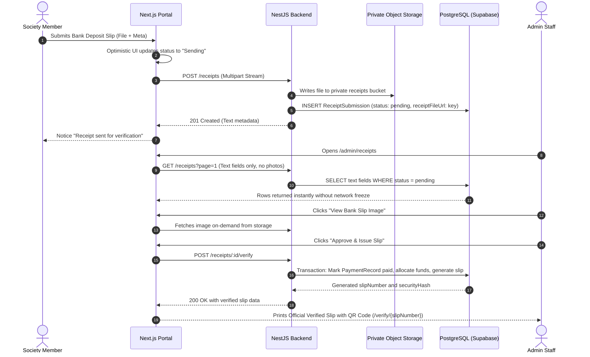

# Prime View Society Management System — Complete System Architecture Specification

**Document Version:** 2.5 (Production Baseline)  
**System Classification:** Enterprise Cooperative Housing Society & Real Estate ERP  
**Organization:** Prime View Co-Operative Housing Society Ltd (Hazara Division, Pakistan)  
**Production URLs:**
- **Frontend Portal:** `https://prime-view-livid.vercel.app`
- **Backend API:** `https://prime-view-backend.onrender.com`
- **Database Engine:** Supabase PostgreSQL 15+ (Pooled & Direct Connection Topology)

---

## 1. Executive Summary & Domain Scope

The **Prime View Society Management System** is a unified digital platform built to modernize, automate, and secure the land allocation, plot reservation, member ledger bookkeeping, and installment payment verification workflows for **Prime View Co-Operative Housing Society Ltd**.

### Key Business Objectives
1. **Zero Double-Bookings:** Enforce strict atomic concurrency guarantees on plot inventory across multi-branch administrative staff without telephone coordination.
2. **Multi-Tier Role Hierarchy & Sector Scoping:** Super Admins exercise global society-wide governance; Sub Admins (e.g., Marketing, Police teams) operate strictly within assigned sector boundaries.
3. **Transparent Member Portal:** Society members access real-time property ledgers, view official installment schedules, track overdue payments, and submit bank deposit slips.
4. **Cryptographic Financial Verification:** Official payment receipt slips feature dual-half print layouts, QR verification codes linking to public `/verify/{slipNumber}` endpoints, and SHA-256 integrity hashes.
5. **Auditable Society Land Records:** Immutable audit logs track every status change, price revision, customer registration, and financial allocation.

---

## 2. High-Level Architecture

The system utilizes a 3-tier decoupled architecture:
1. **Client Tier (Presentation):** Next.js 15 App Router deployed on Vercel Edge Network.
2. **Application Tier (Business Logic & Transactions):** NestJS 11 running on Render, exposing REST endpoints with Passport JWT authentication and Throttler rate limiting.
3. **Data & Storage Tier (Persistence & Events):** PostgreSQL on Supabase with PgBouncer connection pooling, Row-Level Security (RLS), Supabase Realtime WebSockets, and Private Object Storage.



---

## 3. Frontend Architecture (`Prime View frontend`)

The frontend is built with Next.js 15 (App Router) using React 19, TypeScript, Tailwind CSS, Framer Motion, and Zustand.

### 3.1 Portal Routing & Module Hierarchy

```
src/app/
├── (site)/                           ← Public-facing society website
│   ├── page.tsx                      ← Homepage & Master Plan preview
│   ├── our-plans/                    ← Society payment plans (e.g., 7.5 Marla)
│   ├── events-and-media/             ← CMS announcements & YouTube gallery
│   ├── contact/                      ← Public inquiry form (Inquiry model)
│   ├── verify/[slipNumber]/          ← Public QR slip verification desk
│   └── legal-team/, privacy/, terms/ ← Legal & compliance disclosures
├── society-members/                  ← Member Portal
│   ├── login/                        ← Member authentication (Membership No / CNIC)
│   └── (portal)/                     ← Protected member layout & sidebar
│       ├── dashboard/                ← Investment summary, alerts & upcoming dues
│       ├── properties/               ← Owned plots & progress bars
│       ├── payments/                 ← Ledger, installment schedule & receipt upload
│       ├── payments/history/         ← Verified transaction history
│       ├── documents/                ← Applicant photo, CNIC & official certificates
│       └── profile/                  ← Contact update & Next of Kin (5-7-1 mask)
└── admin/                            ← Society Administration Portal
    ├── login/                        ← Role-agnostic administrator authentication
    └── (portal)/                     ← Protected admin shell & drawer
        ├── dashboard/                ← Live KPI cards & inventory summary
        ├── inventory/                ← 4-column inventory table (Available, Reserved, Booked, Allotted)
        ├── master-plan/              ← Level 1 Overview map (7 active blocks)
        ├── master-plan/[blockId]/    ← Level 2 Interactive SVG block map & action drawer
        ├── customers/                ← Sub-Admin fast booking (3-field) & Super Admin registration
        ├── customers-directory/      ← Member dossier, suspension toggles & registration handoff
        ├── receipts/                 ← Text-only receipt queue, modal slip view & instant approval
        ├── sales-history/            ← Society-wide sales log & transaction audit
        ├── reservations/             ← Active 24-hour reservation hold queue
        ├── content/                  ← CMS blocks editor with optimistic locking
        ├── sub-admins/               ← Sub-admin creation, 10 permissions & sector assignment
        ├── audit-log/                ← Immutable audit log with on-demand diff inspection
        └── profile/                  ← Self-service admin profile & avatar update
```

### 3.2 Data Access Layer (DAL) Architecture

No frontend component interacts with the API or data layer directly. All operations route through typed functions in `src/lib/dal/*.ts`:
- **API Cache & Hydration (`apiCache.ts`):** In-memory cache with configurable TTL (default 60s) preventing skeleton screen flashes during tab switches or back-navigation.
- **Strict Typing:** All payloads enforce TypeScript interfaces defined in `src/lib/mock/types.ts` and DAL contracts.
- **Optimistic UI Updates:** State mutations (such as receipt approval and receipt upload) apply immediately to the client store with background reconciliation.

### 3.3 Interactive Master Plan & SVG Coordinate Engine

The master plan operates on two hierarchical levels:
1. **Level 1 (`InteractiveOverviewMap.tsx`):** Traced overview map rendering the 7 active society blocks with dynamic theme colors from `src/lib/map/regionData.ts`.
2. **Level 2 (`InteractiveBlockMap.tsx`):** High-resolution raster map overlaid with SVG polygon coordinates (`<polygon points="...">`) parsed from official town planning blueprints:
   - `abbottBlockAreas.ts` (Abbott Block)
   - `royalBlockAreas.ts` (Royal Block)
   - `overseasBlockAreas.ts` (Overseas Block)
   - `eliteBlockAreas.ts` (Elite Block — includes consolidated Chalet plots)
   - `commercialBlockAreas.ts` (Commercial Block)
   - `npfPhase1BlockAreas.ts` (NPF Phase 1)
   - *NPF Phase 2:* 6 inventory plots; rendered via interactive grid.

**Visual Status Color Tokens:**
- **Available:** Neutral slate (`#f8fafc`, border `#cbd5e1`).
- **Reserved:** Amber warning (`#f59e0b`, border `#b45309`) with remaining hold countdown.
- **Booked:** Bold Crimson (`#ef4444`, border `#b91c1c`). Quick-bookings show `Booked (Needs Reg)`.
- **Allotted:** Emerald green (`#10b981`, border `#047857`) with crisp white typography.
- **Derived Disputed:** Dynamic SVG cross-hatch pattern (`#disputedHatch`) applied when a plot is flagged disputed or when the registered owner's account is suspended. Visual layer only; zero database mutation.
- **Amenity:** Non-sellable public utility areas (Hospital, Mosque, School, Park, Grid Station). Actions are disabled.

---

## 4. Backend Architecture (`Prime view backend`)

The backend is built with **NestJS 11** on the Express engine and Prisma ORM 5.22.

### 4.1 NestJS Modular Architecture

```
src/
├── main.ts                   ← Bootstrap: CORS, ValidationPipe, HSTS, JWT verification
├── app.module.ts             ← Root aggregator importing all domain modules
├── prisma/                   ← PrismaService & scoped session context wrapper
├── auth/                     ← Passport JWT authentication, login lockout & bcrypt hashing
├── blocks/                   ← Block metadata & sector assignments
├── plots/                    ← Plot search, atomic locking, status changes & price updates
├── reservations/             ← 24-hour reservation hold management & release
├── customers/                ← Member directory, minimal quick-booking & registration completion
├── me/                       ← Authenticated member profile & owned plot ledgers
├── admin/                    ← Sub-admin creation, permission registry & profile self-service
├── content/                  ← Content CMS blocks with 30-minute lock leasing
├── receipts/                 ← Text-only queue, image loading, approval & verification slips
├── sweep/                    ← 60-second background cron for lock & reservation expiration
├── storage/                  ← Object storage upload/download signatures
├── sales/                    ← Sales KPI aggregations & transactions log
├── inventory/                ← 4-column inventory statistics & block aggregations
├── health/                   ← Liveness and readiness probes
├── jobs/                     ← Scheduled background tasks
├── inquiries/                ← Public contact form persistence with RLS
└── realtime/                 ← Supabase Realtime broadcast service
```

### 4.2 Security Pipeline & Middleware

1. **Production Boot Safety (`main.ts`):** In production mode, the application checks `JWT_SECRET` length (minimum 32 characters) and rejects known placeholder strings, refusing to boot under weak configurations.
2. **CORS Whitelist:** Locked strictly to `https://prime-view-livid.vercel.app`, `process.env.FRONTEND_URL`, and local development origin. Wildcard (`*`) origin is forbidden.
3. **Transport Security Headers:** Enforces `Strict-Transport-Security: max-age=31536000; includeSubDomains`, `X-Content-Type-Options: nosniff`, and `X-Frame-Options: DENY`.
4. **DTO Whitelisting:** `ValidationPipe` with `{ whitelist: true, transform: true }` prevents mass-assignment vulnerabilities across all mutating endpoints.
5. **Rate Limiting:** `ThrottlerGuard` applies a sliding window (120 requests / 60 seconds) globally, with stricter brute-force throttling on authentication endpoints.

### 4.3 Two-Check Authorization Model

Every incoming request passes through two server-side validation layers:
1. **Permission Check (`PermissionsGuard`):** Validates that the administrator's JWT contains the required permission flag (e.g., `can_book`, `can_reserve`, `can_verify_receipts`, `can_edit_content`).
2. **Block Scope Check (`BlockScopeGuard`):** For sector-scoped actions, verifies that the target plot's `blockId` exists within the administrator's `assignedBlocks` array. Super Admins bypass block restrictions automatically.

---

## 5. Database Architecture & Row-Level Security

### 5.1 Relational Schema & Entity Relationship Overview



### 5.2 Key Tables & Structural Definitions

| Entity | Primary Role & Constraints | Key Columns & Indexes |
|---|---|---|
| `Block` | Society sector definition (7 active blocks) | `id` (PK), `name`, `totalPlots` |
| `Plot` | Real-world land parcel | `id` (PK), `blockId`, `plotNumber`, `status`, `category`, `price`, `version`, `isAdjustment`. Unique `(blockId, plotNumber)`. Indexes: `(blockId, status)`, `(status)` |
| `PlotStatusHistory` | Chronological plot status audit trail | `id`, `plotId`, `fromStatus`, `toStatus`, `changedAt`, `changedBy`, `source`. Indexes: `(plotId, changedAt)`, `(toStatus, changedAt)` |
| `AdminUser` | Staff & administrator accounts | `id`, `username` (UQ), `email` (UQ), `role`, `permissions` (JSON), `failedLoginAttempts`, `lockedUntil` |
| `BlockAssignment` | Sector authority scoping for sub-admins | `id`, `adminId`, `blockId`. Unique `(adminId, blockId)` |
| `Customer` | Society members & property buyers | `id`, `membershipNo` (UQ), `cnic` (Index), `fullName`, `accountStatus`, `registrationStatus`, `nokCnic` |
| `Booking` | Executed land purchase agreement | `id`, `customerId`, `plotId`, `paymentType`, `installmentPlan` (JSON), `registrationStatus`. Index: `(customerId)` |
| `PaymentRecord` | Individual fee or scheduled installment | `id`, `bookingId`, `feeType`, `installmentNumber`, `amount`, `paidAmount`, `status`. Index: `(bookingId, feeType)` |
| `ReceiptSubmission` | Member bank deposit slips | `id`, `customerId`, `bookingId`, `amount`, `paymentKind`, `status`, `slipNumber` (UQ), `securityHash`. Indexes: `(customerId, status)`, `(status, uploadedAt)` |
| `PaymentAllocation` | Waterfall payment distribution record | `id`, `receiptId`, `paymentRecordId`, `amountApplied`, `allocationType`. Indexes: `(receiptId)`, `(paymentRecordId)` |
| `AuditEntry` | Immutable system event log | `id`, `timestamp`, `actorId`, `action`, `entityType`, `entityId`, `oldValue`, `newValue`. Indexes: `(timestamp)`, `(entityType, entityId)`, `(actorId)` |
| `Inquiry` | Public contact form messages | `id`, `name`, `phone`, `message`, `consent`, `createdAt` |

### 5.3 PostgreSQL Row-Level Security (RLS) Policies

All queries executed via `PrismaService.withScopedSession` set local transaction variables:
```sql
SET LOCAL app.current_role = :role;
SET LOCAL app.current_admin_id = :adminId;
SET LOCAL app.current_user_id = :userId;
```

**Database Policies Enforced:**
1. **Plot Scope:** Sub-admins can only SELECT/UPDATE plots within blocks assigned in `BlockAssignment`.
2. **Customer Scope:** Sub-admins can only view customer dossiers owning plots in their assigned sectors.
3. **Audit Log Immutability:** `UPDATE` and `DELETE` grants are revoked from the application database role.
4. **System Sweep Session:** Background cron operations run as `system_sweep` session with bounded system authority.

---

## 6. Core Business Workflows & State Machines

### 6.1 Plot Allocation Lifecycle (Rule D2)



**Allocation Rule (Decision D2 & P3-ALLOT-LAST):**
- **One-Time Booking:** Transitions directly from `Available` -> `Allotted` upon booking completion with upfront payment.
- **Installment Booking:** Transitions from `Available` -> `Booked`. The plot remains in `Booked` status while any statutory fee (Admission Fee PKR 2,000, Share Subscription Fee PKR 10,000, Downpayment) or monthly installment remains outstanding.
- **Automatic Allotment:** When the final payment on the booking ledger is verified, `maybeAllotIfFullyPaid` atomically updates the plot status to `allotted` and writes a `PlotStatusHistory` row.

### 6.2 Waterfall Balloon Payment Allocation

When a member submits a lump-sum or extra payment exceeding an individual installment:
1. The backend verifies payment preview integrity against `previewData` (returns `409 PREVIEW_DRIFT` if schedule shifted).
2. The payment amount cascades sequentially through pending installments in due-date order.
3. Creates a `PaymentAllocation` row (`full` or `partial`) for each affected payment record.
4. **Never overwrites** `PaymentRecord.amount` (contractual schedule remains historically true); updates `paidAmount` and status (`partially_paid` or `paid`).
5. Evaluates `maybeAllotIfFullyPaid` atomically within the same transaction.

### 6.3 Receipts Desk & QR Slip Verification



---

## 7. Society Blocks & Inventory Consolidation

The society master plan consists of **7 official active blocks**:

| Block ID | Block Name | Interactive Map Type | Notes & Consolidation |
|---|---|---|---|
| `abbott` | Abbott Block | Interactive SVG Map | Residential & Commercial plots |
| `royal` | Royal Block | Interactive SVG Map | Residential & Executive plots |
| `overseas` | Overseas Block | Interactive SVG Map | Expatriate overseas sector |
| `elite` | Elite Block | Interactive SVG Map | Incorporates consolidated Chalet plots |
| `commercial` | Commercial Block | Interactive SVG Map | High-street commercial shopping plots |
| `npf_1` | NPF Phase 1 | Interactive SVG Map | National Police Foundation Phase 1 |
| `npf_2` | NPF Phase 2 | Interactive Grid View | 6 inventory plots; no physical SVG blueprint |

> **Chalet Block Pruning & Consolidation:**
> Chalet Block was formally retired and consolidated into Elite Block. Unassigned plots with no booking, reservation, owner, or payment records were deleted. The 1 historical allotted Chalet plot was preserved in place for audit integrity. Chalet has been removed from seed scripts, types, frontend navigation, and sub-admin sector assignment pickers.

---

## 8. Verification & Operational Reference

### Local Development Startup

```bash
# Backend (NestJS + Prisma)
cd "Prime view backend"
npm install
# Configure .env (DATABASE_URL, DIRECT_URL, JWT_SECRET, FRONTEND_URL)
npm run start:dev
# Running on http://localhost:3001

# Frontend (Next.js 15)
cd "Prime View frontend"
npm install
# Configure .env.local (NEXT_PUBLIC_API_URL=http://localhost:3001)
npm run dev
# Running on http://localhost:3000
```

### Static Analysis & Type Checking

```bash
# Verify Frontend types
cd "Prime View frontend"
npx tsc --noEmit

# Verify Backend types & Prisma validation
cd "Prime view backend"
npx prisma validate
npx tsc --noEmit
```

---

*This system architecture document represents the ground truth of the Prime View Society Management System codebase and production deployments.*
